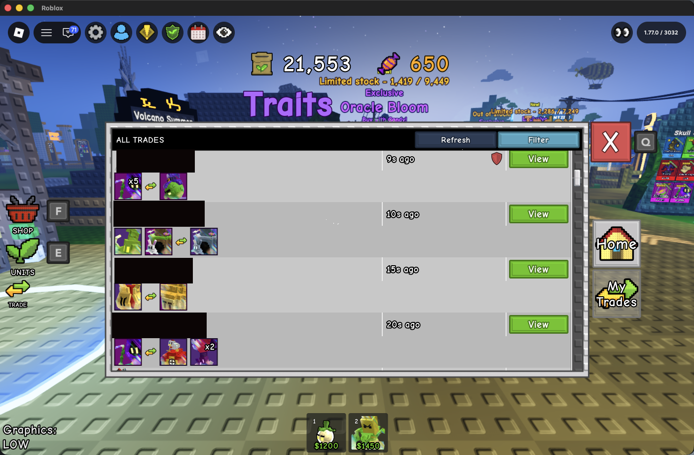

# GTD Value Overlay

Overlay value unit untuk menu trade **Garden Tower Defense** (Roblox). Program scan window Roblox, mengenali ikon unit, lalu menampilkan value di atas tiap ikon, lengkap dengan total per sisi trade dan selisihnya.

Program ini **hanya membaca layar** (screenshot). Tidak ada injeksi atau modifikasi client Roblox.



## Fitur

- Value muncul di atas ikon unit secara otomatis
- Scan **hanya window Roblox**, dan hanya area daftar trade (bukan dunia game)
- Baca badge qty (`x6`) lewat pencocokan bentuk huruf (tanpa OCR, tidak perlu instal apa pun), value otomatis dikali qty
- Total value per sisi trade (**Punya** vs **Cari**) beserta selisih (hijau = untung, merah = rugi)
- Deteksi cepat: grayscale, multi-thread, dan dilewati kalau layar tidak berubah
- Overlay tetap tampil di atas Roblox walau window Roblox sedang fokus
- Update `values.json` dari post update value Discord dengan satu perintah, aman dari file lama

## Struktur folder

```
gtd-value-overlay/
├── src/
│   └── gtd_value/
│       ├── gtd_value.py       # program utama (overlay, tool shot & crop)
│       ├── update_values.py   # parser post update Discord -> data/values.json
│       ├── qty_digits.py      # baca badge qty (xN) lewat pencocokan bentuk huruf
│       └── paths.py           # satu-satunya tempat definisi path folder
├── data/
│   ├── values.json            # data value unit
│   ├── arrow.png              # template ikon panah ⇄ (untuk total per sisi)
│   └── glyphs/                # template huruf badge qty: x, 0-9
├── templates/                 # template ikon unit (dibuat sendiri lewat tool crop)
├── updates/                   # simpan tiap post update Discord di sini (file teks)
├── packaging/                 # build jadi aplikasi (spec PyInstaller, ikon, skrip build)
├── docs/
│   └── screenshot.png         # gambar untuk README
├── requirements.txt
└── README.md
```

Semua path dihitung dari lokasi `paths.py` (`ROOT = parents[2]`), jadi program bisa dijalankan dari folder mana pun. Kalau `paths.py` dipindah ke kedalaman folder yang lain, ubah angka `parents[...]`-nya.

## Instalasi

1. Python 3.9+
2. Install library:

   ```
   pip install -r requirements.txt
   ```

3. Library khusus OS (untuk mencari window Roblox dan menjaga overlay tetap tampil):
   - Mac: `pip install pyobjc-framework-Quartz pyobjc-framework-Cocoa`
   - Windows: `pip install pywin32`

   Kalau `requirements.txt` sudah memuatnya (dengan penanda `sys_platform`), langkah ini otomatis ikut langkah 2.

4. **Mac:** beri izin *Screen Recording* ke Terminal/IDE yang dipakai di System Settings > Privacy & Security.

Semua perintah di bawah dijalankan dari **root repo**.

## Setup awal (sekali saja)

### 1. Ambil screenshot window Roblox

Buka menu trade di game, lalu jalankan:

```
python src/gtd_value/gtd_value.py shot
```

Kamu punya 3 detik untuk pindah ke Roblox. Hasilnya `screenshot.png` (hanya window Roblox).

### 2. Crop ikon unit jadi template

```
python src/gtd_value/gtd_value.py crop screenshot.png
```

Untuk tiap unit: drag kotak pas di border ikon, tekan **Enter**, lalu ketik nama unit. Tekan **Esc** kalau sudah selesai. Hasilnya masuk ke `templates/`.

- Nama harus **sama persis** dengan key di `data/values.json`.
- Varian visual (mutasi, rainbow, dll.) disimpan sebagai template tambahan, misalnya `Nama Unit__shiny.png`. Program menganggapnya unit yang sama.
- Ambil screenshot dari window yang ukurannya sama dengan yang dipakai saat main, supaya skala template cocok.

### 3. Crop panah trade (untuk total per sisi)

Di tool crop yang sama, crop **hanya ikon panah ⇄** serapat mungkin dan beri nama `arrow`. Hasilnya `data/arrow.png`. Tanpa file ini, label value per unit tetap jalan, tapi total per sisi nonaktif.

### 4. Isi data/values.json

Format boleh angka saja atau objek:

```json
{
  "Grim Gardener": { "value": 36.5, "demand": 8 },
  "Ghost Shroom": 2.55
}
```

Tapi cara paling gampang adalah lewat update Discord (lihat bagian di bawah).

## Menjalankan

```
python src/gtd_value/gtd_value.py
```

Buka menu trade di Roblox dan overlay akan muncul. `Ctrl+C` di terminal untuk berhenti.

Di baris trade kamu akan melihat:

- **Label kuning di atas ikon**: value unit, atau `value ×qty = total` kalau ada badge qty
- **Kotak di kanan unit terakhir**: `Punya` (sisi kiri panah), `Cari` (sisi kanan panah), dan `Selisih`

Setelah mengubah `data/values.json`, **restart program** karena file itu hanya dibaca saat start.

## Update value dari Discord

Simpan tiap post update jadi file teks di `updates/` yang **namanya memuat tanggal rilis**, lalu jalankan:

```
python src/gtd_value/update_values.py updates/update_2026-11-13.txt   # satu file
python src/gtd_value/update_values.py updates/*.txt                    # banyak file sekaligus, urutan bebas
python src/gtd_value/update_values.py clip                             # dari clipboard (pip install pyperclip), tanggal = hari ini
python src/gtd_value/update_values.py                                  # paste di terminal, akhiri Ctrl+D (Mac) / Ctrl+Z lalu Enter (Windows)
python src/gtd_value/update_values.py file.txt --date 2026-11-13       # paksa tanggal kalau nama file tidak memuat tanggal
```

### Aman dari file lama (anti-menimpa)

Tiap unit di `data/values.json` menyimpan tanggal update terakhirnya (`"updated"`). Kalau kamu memproses file yang tanggalnya **lebih lama** dari tanggal itu, unit tersebut **dilewati** dan value terbaru tidak tertimpa. Kalau banyak file diberikan sekaligus, script memprosesnya dari yang paling lama ke yang paling baru, jadi urutan penulisan tidak berpengaruh.

- Format tanggal di nama file: `2026-11-13`, `20261113`, atau `13-11-2026` (hari-bulan-tahun).
- Nama file tanpa tanggal ditolak. Tambahkan `--date YYYY-MM-DD` atau ganti nama filenya.
- Unit yang belum punya tanggal (data lama atau diisi manual) tetap ditimpa pada update pertama.
- Tanggal yang sama boleh diproses ulang (hasilnya sama).

### Yang dilakukan script

- Hanya unit yang ada di post yang diubah, unit lain dibiarkan
- Nilai yang dipakai adalah sisi kanan `-->` (nilai terbaru)
- Unit yang di post hanya berubah demand/status (tanpa baris `Value:`) juga didukung: yang diubah cuma demand/status, value-nya dibiarkan
- Nama unit dicocokkan tanpa peduli huruf besar/kecil
- Menyimpan `value`, `demand`, `status`, `tier` (EXCLUSIVE/GODLY, dst.), dan `updated`
- Backup otomatis ke `data/values.json.bak`
- Unit baru ditandai di output, cek ejaannya dengan nama template

**Skala angka:** secara default value disimpan dalam ribuan (`30.45k+` jadi `30.45`). Kalau `data/values.json`-mu memakai angka penuh, ubah `STORE_IN_K = False` di `update_values.py`. Jangan campur dua skala dalam satu file.

## Membuat aplikasi (build)

Aplikasi dibangun dengan PyInstaller. Build harus dilakukan di OS tujuan (`.app` hanya bisa dibuat di Mac, `.exe` hanya di Windows).

**Mac:**

```
bash packaging/build_mac.sh          # hasil: dist/GTDValue.app
```

**Windows:**

```
packaging\build_windows.bat          # hasil: dist\GTDValue\GTDValue.exe
```

Di mode aplikasi:

- Template, `values.json` awal, `arrow.png`, dan `glyphs/` ikut dibundel (read-only).
- Data user dan log ditulis ke folder standar OS: `~/Library/Application Support/GTDValue` dan `~/Library/Logs/GTDValue` (Mac), `%LOCALAPPDATA%\GTDValue` (Windows). `values.json` di folder itu disalin dari bundle saat pertama jalan dan tidak ditimpa lagi.
- Tidak ada ikon di Dock/taskbar. Kontrol lewat ikon **V** di tray: Jeda, Muat ulang values, Buka folder data/log, Jalan otomatis saat login, Keluar.
- **Mac, pertama kali dibuka:** izinkan *Screen Recording* untuk GTDValue di System Settings > Privacy & Security, lalu **Keluar dari app dan buka lagi**.
- **Mac, supaya izin tidak hilang tiap build ulang:** build dengan tanda tangan tetap. Buat sertifikat di Keychain Access > Certificate Assistant > Create a Certificate (tipe Code Signing, misalnya bernama `GTDValue Dev`), lalu jalankan `SIGN_IDENTITY="GTDValue Dev" bash packaging/build_mac.sh`. Tanpa itu dipakai tanda tangan ad-hoc, dan izin bisa perlu diberikan ulang setelah build baru.
- Build yang dibuat di Mac-mu sendiri langsung bisa dibuka. App yang **diunduh orang lain** akan diblokir Gatekeeper (Mac) atau SmartScreen (Windows) karena belum ditandatangani developer: di Mac buka lewat klik kanan > Open, di Windows klik "More info" > "Run anyway".

## Konfigurasi

Konstanta di bagian atas `gtd_value.py`:

| Nama | Fungsi |
|---|---|
| `THRESHOLD` | Ketat tidaknya pencocokan unit (mode warna). Naikkan kalau salah deteksi, turunkan kalau unit tidak terbaca |
| `USE_GRAY` | `True`: deteksi grayscale, jauh lebih cepat. `False`: mode warna, lebih ketat tapi lebih lambat |
| `THRESHOLD_GRAY` | Threshold khusus mode grayscale (default `0.85`, lebih tinggi karena grayscale lebih longgar) |
| `ROI` | Area daftar trade relatif terhadap window Roblox: `(kiri, atas, kanan, bawah)`, nilai 0 sampai 1. `None` = scan seluruh window |
| `FRAME_DIFF` | Seberapa besar perubahan layar sebelum deteksi dijalankan ulang. Makin kecil makin sensitif |
| `REDETECT_EVERY` | Paksa deteksi ulang tiap N detik sebagai pengaman |
| `ARROW_THRESHOLD` | Threshold deteksi panah |
| `SCAN_INTERVAL` | Jeda antar scan (detik). `0.3` cocok kalau deteksi dilewati saat layar diam |
| `SCALES` | Tambah ke `(0.9, 1.0, 1.1)` kalau ukuran UI berubah-ubah (scan jadi lebih lambat) |
| `ACCEPT_VIEW` | `True`: selisih = kiri - kanan. `False`: kebalikannya |

## Troubleshooting

| Masalah | Solusi |
|---|---|
| Pesan `Tidak ada template di: <path>` | Folder yang dibaca ada di pesan itu. Pastikan `templates/` di root berisi file `.png` dan `paths.py` menunjuk ke sana |
| Overlay kosong | Pastikan window Roblox terlihat (tidak tertutup window lain) dan `templates/` ada isinya |
| Unit tidak dapat label | Template belum ada atau skor di bawah threshold. Turunkan sedikit, atau crop ulang template |
| Unit di tepi daftar tidak dapat label | Area `ROI` terlalu sempit. Lebarkan sedikit |
| Label nyasar di luar menu trade, atau di teks | False positive. Pastikan `ROI` terpasang, naikkan `THRESHOLD_GRAY`, atau set `USE_GRAY = False` |
| Label `?` | Nama unit tidak ada di `data/values.json` atau ejaannya beda dengan nama template |
| Qty `xN` tidak terbaca atau salah | Badge baru terkonfirmasi setelah 2 scan (~1 detik). Pastikan `data/glyphs/` berisi template huruf. Kalau satu angka sering salah, kirim crop badge-nya (`x8`, `x9`, dst.) untuk ditambahkan sebagai `<angka>__real.png` di `data/glyphs/`. Huruf yang ragu dianggap qty 1, bukan ditebak |
| Total per sisi tidak muncul | `data/arrow.png` belum ada, atau turunkan `ARROW_THRESHOLD` ke 0.60 |
| Overlay hilang saat fokus ke Roblox (Mac) | Pastikan `pyobjc-framework-Cocoa` terpasang dan `mac_always_visible()` dipanggil setelah `ov.show()` |
| Window Roblox tidak ketemu (Windows) | Judul window harus persis `Roblox`. Cek di Task Manager |
| Total terlihat terlalu kecil | Ada ikon yang tidak terdeteksi (tidak punya label). Total hanya menjumlahkan unit yang terdeteksi |
| `+?` di total | Ada unit terdeteksi tapi value-nya belum ada di `data/values.json` |

## Batasan

- Deteksi memakai template matching: satu template cocok untuk satu tampilan. Unit dengan varian visual perlu template sendiri.
- Total dan selisih **hanya menghitung unit yang terdeteksi**. Percaya angkanya kalau semua ikon di baris itu punya label.
- Selisih hanya membandingkan value. Demand dan status unit tidak ikut dihitung, jadi anggap sebagai filter cepat, bukan keputusan final.
- Angka `ROI` mengasumsikan rasio window Roblox seperti saat dihitung. Kalau rasio window berubah banyak, sesuaikan.
- Mengasumsikan Roblox ada di monitor utama.
- Akurasi data bergantung pada sumber value (post komunitas di Discord).